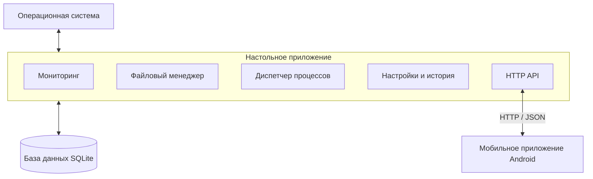

# Задание на учебную практику

## Разработка программного комплекса мониторинга и управления ресурсами компьютерной системы «System Monitor»

**Специальность:** 09.02.07 «Информационные системы и программирование».  
**Курс:** 4-й.  
**Продолжительность:** 72 академических часа.  
**Форма выполнения:** индивидуальная.  
**Языки программирования и технологии:** на ваш выбор при условии выполнения всех требований задания.

## 1. Цель учебной практики

Получение практического опыта разработки программных модулей в соответствии с техническим заданием, взаимодействия с аппаратным обеспечением и операционной системой, разработки настольных и мобильных приложений, работы с базами данных, отладки, тестирования, рефакторинга, оптимизации и документирования программного обеспечения в соответствии с Единой системой программной документации (ЕСПД).

## 2. Формируемые профессиональные компетенции

| Код | Наименование профессиональной компетенции |
|---|---|
| ПК 1.1 | Формировать алгоритмы разработки программных модулей в соответствии с техническим заданием |
| ПК 1.2 | Разрабатывать программные модули в соответствии с техническим заданием |
| ПК 1.3 | Выполнять отладку программных модулей с использованием специализированных программных средств |
| ПК 1.4 | Выполнять тестирование программных модулей |
| ПК 1.5 | Осуществлять рефакторинг и оптимизацию программного кода |
| ПК 1.6 | Разрабатывать модули программного обеспечения для мобильных платформ |

## 3. Содержание учебной практики

В ходе прохождения учебной практики вам необходимо выполнить следующие виды работ:

1. Организация взаимодействия с аппаратным обеспечением.
2. Управление файлами, атрибутами и каталогами.
3. Управление процессами.
4. Работа с базами данных, графикой и анимацией.
5. Анализ результатов тестирования программы.
6. Документирование программного обеспечения в соответствии с Единой системой программной документации.

Все перечисленные виды работ должны выполняться в рамках разработки единого программного комплекса.

## 4. Постановка задачи

Вам необходимо разработать программный комплекс **System Monitor**, предназначенный для получения информации о состоянии компьютерной системы, мониторинга использования аппаратных ресурсов, управления файлами и каталогами, управления процессами операционной системы и удалённого просмотра текущих показателей с мобильного устройства.

Программный комплекс должен включать:

- настольное приложение с графическим пользовательским интерфейсом;
- базу данных для хранения истории показателей, настроек и журнала событий;
- HTTP API для предоставления информации мобильному приложению;
- мобильное приложение для операционной системы Android.

Настольное приложение должно получать реальные сведения об аппаратном обеспечении компьютера, взаимодействовать с файловой системой и процессами операционной системы, сохранять результаты мониторинга в базу данных и отображать их в графическом виде.

Мобильное приложение должно получать сведения от настольного приложения по сети и предоставлять возможность удалённого просмотра текущего состояния компьютерной системы.

### 4.1. Общая архитектура программного комплекса



Серверную часть допускается реализовать непосредственно внутри настольного приложения. Разработка отдельного серверного приложения не является обязательной.

Не требуется обеспечивать поддержку нескольких компьютеров одновременно, удалённое управление файлами и процессами, многопользовательский режим и сложную систему разграничения прав доступа.

## 5. Выбор технологий разработки

Вы самостоятельно выбираете языки программирования, библиотеки и инструменты разработки.

| Компонент | Рекомендуемые технологии |
|---|---|
| Настольное приложение | C# WPF, WinForms, Avalonia, Python PySide6, PyQt6, C++ Qt, JavaFX |
| Взаимодействие с операционной системой | Системные API, Windows API, WMI, psutil, стандартные библиотеки языка |
| База данных | SQLite |
| HTTP API | ASP.NET Core, FastAPI, Flask или аналогичные инструменты |
| Графики и диаграммы | ScottPlot, LiveCharts, PyQtGraph, Qt Charts и другие библиотеки |
| Мобильное приложение | Kotlin, Java, .NET MAUI, Flutter |
| Тестирование | pytest, unittest, xUnit, NUnit, JUnit, GoogleTest |
| Контроль версий | Git, GitLab |

Допускается использование других технологий при условии выполнения всех функциональных требований. Разрешается использовать сторонние библиотеки для взаимодействия с операционной системой, работы с базой данных, построения графиков, реализации сетевого взаимодействия и создания пользовательского интерфейса. При этом основная логика программного комплекса должна быть разработана вами самостоятельно.

## 6. Функциональные требования к настольному приложению

### 6.1. Общие требования к пользовательскому интерфейсу

Настольное приложение должно иметь графический пользовательский интерфейс на русском языке.

| Раздел | Назначение |
|---|---|
| Мониторинг | Просмотр информации об оборудовании и текущих показателей |
| Файлы | Управление файлами, атрибутами и каталогами |
| Процессы | Просмотр и управление процессами операционной системы |
| История и настройки | Просмотр сохранённых данных и изменение параметров приложения |

Способ организации навигации между разделами вы определяете самостоятельно. Допускается использование вкладок, бокового меню, отдельных окон или других элементов интерфейса. Интерфейс должен быть понятным, обеспечивать доступ ко всем предусмотренным функциям и отображать сообщения об успешном выполнении операций и возникших ошибках.

### 6.2. Организация взаимодействия с аппаратным обеспечением

Необходимо разработать программный модуль получения информации об аппаратном обеспечении компьютера.

**Информация о процессоре:** модель процессора, количество логических процессоров, количество физических ядер при доступности этих сведений и текущая загрузка процессора в процентах.

**Информация об оперативной памяти:** общий объём оперативной памяти, используемый и доступный объём, процент использования памяти.

**Информация о накопителях:** список доступных дисков или разделов, их общий объём, свободное и занятое пространство, процент заполненности.

Все сведения должны получаться средствами операционной системы или специализированных библиотек. Запрещается использовать заранее заданные значения, случайные числа или имитацию показателей вместо получения реальных данных.

Текущие показатели загрузки процессора и оперативной памяти должны обновляться автоматически. Интервал обновления должен задаваться в настройках приложения.

Если получение отдельных сведений невозможно из-за ограничений операционной системы или оборудования, приложение должно корректно обрабатывать такую ситуацию и отображать сообщение о недоступности информации.

### 6.3. Управление файлами, атрибутами и каталогами

Необходимо разработать упрощённый файловый менеджер.

#### Просмотр файловой системы

- выбор рабочего каталога;
- просмотр содержимого текущего каталога;
- переход во вложенные каталоги;
- переход в родительский каталог;
- отображение текущего пути;
- различение файлов и каталогов в интерфейсе.

#### Операции с файлами и каталогами

Необходимо реализовать создание файлов и каталогов, копирование, перемещение, переименование и удаление.

Перед удалением файла или каталога программа должна запрашивать подтверждение пользователя. При попытке выполнить операцию с уже существующим файлом необходимо отображать сообщение о конфликте имён и не допускать непреднамеренной перезаписи данных.

#### Работа с атрибутами

Для выбранного файла необходимо отображать:

- имя;
- расширение;
- полный путь;
- размер;
- дату последнего изменения;
- дату создания, если она доступна;
- поддерживаемые операционной системой атрибуты.

Необходимо реализовать изменение как минимум одного доступного атрибута файла, например «Только чтение» или «Скрытый».

#### Обработка ошибок

Программа должна корректно обрабатывать отсутствие файла или каталога, недостаточные права доступа, некорректные имена, конфликт имён и невозможность выполнения операции.

Все операции, изменяющие состояние файловой системы, должны фиксироваться в журнале событий.

**Требование безопасности:** создание, изменение, перемещение и удаление файлов и каталогов должны выполняться только внутри специально выбранного рабочего каталога. Не допускайте выхода за его пределы через относительные пути, символические ссылки и другие механизмы файловой системы. Для испытаний используйте специально подготовленные тестовые файлы.

### 6.4. Управление процессами

Необходимо разработать программный модуль управления процессами операционной системы.

#### Просмотр процессов

| Поле | Описание |
|---|---|
| PID | Идентификатор процесса |
| Название | Название процесса |
| Память | Объём используемой оперативной памяти |

Допускается отображение дополнительных сведений, если они доступны. Необходимо предусмотреть возможность обновления списка процессов.

#### Запуск процессов

Приложение должно позволять выбирать исполняемый файл или другое поддерживаемое приложение и запускать его средствами операционной системы. При невозможности запуска необходимо отображать соответствующее сообщение об ошибке.

#### Завершение процессов

Необходимо реализовать завершение тестовых процессов, запущенных непосредственно из разрабатываемого приложения. Перед завершением процесса необходимо запрашивать подтверждение пользователя.

Программа не должна позволять завершать критические системные процессы, саму себя или произвольные процессы других приложений. Необходимо корректно обрабатывать ситуацию, когда выбранный процесс уже завершился или недоступен для управления.

Все действия по запуску и завершению процессов должны сохраняться в журнале событий.

### 6.5. Работа с базой данных

Для хранения информации необходимо использовать реляционную базу данных. Рекомендуется SQLite, поскольку она не требует развёртывания отдельного сервера СУБД. Необходимо самостоятельно разработать структуру базы данных.

Рекомендуемая структура включает три таблицы.

#### Таблица `resource_metrics`

Предназначена для хранения истории показателей использования аппаратных ресурсов.

| Поле | Назначение |
|---|---|
| `id` | Уникальный идентификатор записи |
| `recorded_at` | Дата и время получения показателей |
| `cpu_usage` | Загрузка процессора в процентах |
| `memory_usage` | Использование оперативной памяти в процентах |

#### Таблица `events`

Предназначена для хранения журнала событий.

| Поле | Назначение |
|---|---|
| `id` | Уникальный идентификатор события |
| `created_at` | Дата и время события |
| `category` | Категория события |
| `operation` | Выполненная операция |
| `description` | Описание события |
| `status` | Результат выполнения операции |

#### Таблица `settings`

Предназначена для хранения настроек приложения.

| Поле | Назначение |
|---|---|
| `key` | Уникальное наименование параметра |
| `value` | Значение параметра |

Приведённая структура является рекомендуемой. Вы можете изменить её, добавить необходимые поля и таблицы.

#### Обязательные операции с базой данных

- автоматическое создание базы данных и необходимых таблиц при первом запуске;
- добавление записей о состоянии аппаратных ресурсов;
- добавление записей в журнал событий;
- получение истории показателей;
- получение истории за выбранный период;
- просмотр журнала событий;
- сохранение и изменение настроек;
- очистка истории показателей и журнала событий с подтверждением пользователя.

Интервал сохранения показателей в базу данных допускается сделать отличным от интервала обновления пользовательского интерфейса.

При работе с базой данных необходимо использовать параметризованные запросы или ORM. Не допускается формирование SQL-запросов путём непосредственной подстановки пользовательского ввода.

Данные и настройки должны сохраняться после завершения и повторного запуска программы.

### 6.6. Работа с графикой и анимацией

В разделе мониторинга необходимо реализовать графическое отображение текущего состояния компьютерной системы.

Обязательные графические элементы:

1. График изменения загрузки процессора во времени.
2. График изменения использования оперативной памяти во времени.
3. Графический индикатор заполненности выбранного накопителя.
4. Числовые индикаторы текущих показателей.
5. Не менее одного анимированного элемента интерфейса.

Графики должны обновляться при получении новых показателей. Необходимо ограничить количество одновременно отображаемых точек, чтобы продолжительная работа приложения не приводила к бесконтрольному увеличению потребления памяти.

В качестве анимации допускается использовать плавное изменение полосы загрузки, кругового индикатора или другого графического элемента при обновлении показателей. Простое периодическое изменение числового значения без визуального перехода не считается реализацией анимации.

**Пример интерфейса (демонстрационные данные):**

| Процессор | Память | Диск |
|:---:|:---:|:---:|
| 42% | 68% | 54% |

| Время | ЦП | ОЗУ |
|---|---:|---:|
| 12:00 | 25% | 62% |
| 12:01 | 40% | 63% |
| 12:02 | 33% | 65% |
| 12:03 | 57% | 64% |
| 12:04 | 71% | 69% |
| 12:05 | 34% | 68% |
| 12:06 | 42% | 68% |

Навигация: **Мониторинг · Файлы · Процессы · Настройки**.

Данный пример приведён исключительно в качестве иллюстрации. Вы самостоятельно определяете дизайн приложения и расположение элементов управления.

### 6.7. Настройки приложения

Необходимо предусмотреть возможность изменения следующих параметров:

- рабочий каталог файлового менеджера;
- интервал обновления показателей;
- интервал сохранения показателей в базу данных;
- порт HTTP API.

Настройки должны проверяться на допустимость значений и сохраняться между запусками приложения.

## 7. Требования к мобильному приложению

В рамках реализации профессиональной компетенции ПК 1.6 необходимо разработать мобильное приложение для операционной системы Android, предназначенное для удалённого просмотра текущего состояния компьютерной системы.

Мобильное приложение должно являться самостоятельным программным продуктом, устанавливаемым на мобильное устройство или запускаемым в эмуляторе Android.

### 7.1. Экран мониторинга

На основном экране необходимо отображать:

- имя компьютера;
- состояние подключения;
- текущую загрузку процессора;
- процент использования оперативной памяти;
- процент заполненности накопителя;
- дату и время последнего получения данных.

Необходимо предусмотреть кнопку ручного обновления показателей, а также автоматическое обновление через заданный промежуток времени.

При отсутствии подключения приложение должно отображать соответствующее сообщение. Последние успешно полученные данные не должны выдаваться за актуальные.

### 7.2. Экран настроек

Необходимо предусмотреть возможность изменения следующих параметров:

- IP-адрес или имя компьютера;
- порт HTTP API;
- интервал автоматического обновления показателей.

Настройки должны сохраняться после завершения работы мобильного приложения.

Пример возможного интерфейса (демонстрационные данные):

| Экран мониторинга | Экран настроек |
|---|---|
| WORKSTATION-01 — подключено | Адрес компьютера: `192.168.1.100` |
| Процессор: 42% | Порт: `8080` |
| Оперативная память: 68% | Интервал обновления: 5 секунд |
| Накопитель: 54% | Проверить подключение |
| Обновлено в 12:06:30 | Сохранить |
| Обновить | |

### 7.3. Обработка ошибок

Мобильное приложение должно корректно обрабатывать:

- отсутствие сетевого подключения;
- недоступность настольного приложения;
- некорректный адрес сервера;
- некорректный номер порта;
- превышение времени ожидания ответа;
- получение некорректных данных от сервера.

Выполнение сетевых запросов не должно приводить к блокировке пользовательского интерфейса.

Реализация удалённого управления компьютером, просмотра файлов, завершения процессов и получения истории показателей в мобильном приложении не является обязательной.

## 8. Организация сетевого взаимодействия

Взаимодействие настольного и мобильного приложений необходимо реализовать посредством HTTP API с передачей данных в формате JSON.

HTTP API может быть встроен в настольное приложение или реализован в виде отдельного программного модуля.

### 8.1. Получение текущих показателей

Необходимо реализовать следующий метод:

```http
GET /api/status
```

Метод должен возвращать сведения о текущем состоянии компьютерной системы.

Пример ответа:

```json
{
  "computerName": "WORKSTATION-01",
  "timestamp": "2026-11-24T12:00:00Z",
  "cpu": {
    "model": "Intel Core i5",
    "logicalCores": 8,
    "usagePercent": 42.5
  },
  "memory": {
    "totalBytes": 17179869184,
    "usedBytes": 11682311045,
    "usagePercent": 68.0
  },
  "disk": {
    "name": "C:",
    "totalBytes": 500000000000,
    "freeBytes": 230000000000,
    "usagePercent": 54.0
  }
}
```

Приведённые значения являются демонстрационными. В разработанном приложении необходимо возвращать реальные показатели. Структуру JSON допускается изменять при условии сохранения необходимых данных.

### 8.2. Проверка доступности сервера

Рекомендуется дополнительно реализовать метод:

```http
GET /api/health
```

Пример ответа:

```json
{
  "status": "ok"
}
```

Данный метод может использоваться для проверки подключения при настройке мобильного приложения.

### 8.3. Требования к безопасности

HTTP API должен предоставлять только информацию о состоянии компьютера. Не допускается реализация через него произвольного выполнения команд операционной системы.

Сетевое взаимодействие необходимо проверять в пределах изолированной учебной или локальной сети. Не допускается публикация незащищённого HTTP API в интернете.

При разработке необходимо учитывать возможность одновременной работы графического интерфейса, модуля мониторинга и HTTP API.

## 9. Нефункциональные требования

### 9.1. Надёжность

Программный комплекс должен корректно обрабатывать исключительные ситуации. Возникновение ошибки в одном из модулей не должно приводить к аварийному завершению всего приложения, если продолжение работы возможно. Сообщения об ошибках должны быть понятны пользователю.

### 9.2. Производительность

Получение сведений об аппаратном обеспечении, обращение к базе данных и выполнение сетевых запросов не должны приводить к продолжительной блокировке пользовательского интерфейса.

Необходимо исключить:

- бесконтрольное увеличение количества точек на графиках;
- бесконечное накопление объектов в оперативной памяти;
- создание избыточного количества потоков;
- многократное выполнение одинаковых ресурсоёмких операций без необходимости.

### 9.3. Удобство использования

Интерфейсы настольного и мобильного приложений должны быть выполнены на русском языке. Элементы управления должны иметь понятные названия. Единицы измерения отображаемых величин должны быть явно указаны. При выполнении потенциально опасных операций необходимо запрашивать подтверждение пользователя.

### 9.4. Сопровождаемость

Исходный код должен иметь логичную структуру.

Необходимо обеспечить:

- разделение пользовательского интерфейса и основной логики;
- выделение самостоятельных программных модулей;
- понятное именование переменных, функций, методов и классов;
- отсутствие неоправданного дублирования кода;
- обработку исключений;
- наличие комментариев в сложных участках программы.

Размещение всей логики программного комплекса в одном файле или классе не допускается.

### 9.5. Требования к совместимости

Настольное приложение должно работать как минимум под одной выбранной операционной системой. Мобильное приложение должно работать под Android на физическом устройстве или в эмуляторе. Поддержка нескольких настольных операционных систем не является обязательной.

## 10. Порядок выполнения учебной практики

### 10.1. Анализ требований и проектирование программных модулей

Перед началом разработки изучите требования настоящего задания и определите способы их реализации.

1. Выберите языки программирования и технологии.
2. Определите состав программных модулей.
3. Разработайте архитектуру программного комплекса.
4. Спроектируйте структуру базы данных.
5. Разработайте алгоритмы функционирования основных модулей.
6. Подготовьте макеты пользовательских интерфейсов.
7. Определите формат взаимодействия между настольным и мобильным приложениями.
8. Подготовьте техническое задание в соответствии с ЕСПД.

Необходимо разработать не менее пяти блок-схем или алгоритмов на псевдокоде, описывающих:

- получение и обновление показателей аппаратного обеспечения;
- выполнение операции с файлом или каталогом;
- запуск или завершение процесса;
- сохранение показателей в базу данных;
- получение и обработку данных мобильным приложением.

Также необходимо подготовить архитектурную схему программного комплекса и схему структуры базы данных. Вы самостоятельно принимаете архитектурные решения, не противоречащие требованиям задания.

**Формируемая компетенция: ПК 1.1.**

### 10.2. Разработка программных модулей

На основании разработанных алгоритмов и архитектуры реализуйте программные модули.

Рекомендуемый порядок разработки:

1. Создание проекта и Git-репозитория.
2. Разработка модуля взаимодействия с аппаратным обеспечением.
3. Создание основного графического интерфейса.
4. Разработка файлового менеджера.
5. Разработка модуля управления процессами.
6. Создание базы данных.
7. Реализация истории показателей и журнала событий.
8. Реализация графиков и анимации.
9. Разработка HTTP API.
10. Разработка мобильного приложения.
11. Интеграция всех компонентов.

После реализации каждого модуля выполните предварительную проверку его работоспособности.

**Формируемые компетенции: ПК 1.2, ПК 1.6.**

### 10.3. Отладка программных модулей

В процессе разработки необходимо использовать специализированные средства отладки, предоставляемые выбранной средой разработки.

Продемонстрируйте использование следующих возможностей:

- установка точек останова;
- пошаговое выполнение программы;
- просмотр значений переменных;
- анализ стека вызовов;
- анализ возникающих исключений.

Необходимо задокументировать не менее трёх случаев применения средств отладки. В качестве таких случаев могут рассматриваться обнаружение причины ошибки, исследование поведения алгоритма, проверка значений переменных или анализ взаимодействия программных модулей.

| № | Исследуемый модуль | Описание ситуации | Средство отладки | Полученный результат | Выполненные изменения |
|---:|---|---|---|---|---|
| 1 | | | | | |
| 2 | | | | | |
| 3 | | | | | |

Для каждого случая приложите снимок экрана, демонстрирующий использование средств отладки, и ссылку на соответствующий коммит, если по результатам отладки были внесены изменения.

Не требуется искусственно создавать ошибки в программе. Необходимо продемонстрировать фактическое применение инструментов отладки.

**Формируемая компетенция: ПК 1.3.**

## 11. Тестирование программного обеспечения

### 11.1. Общие требования

После разработки программных модулей необходимо провести тестирование программного комплекса. Тестирование должно быть направлено на выявление дефектов и проверку соответствия реализованных функций требованиям технического задания.

| Вид тестирования | Назначение |
|---|---|
| Модульное | Проверка отдельных функций, методов и классов |
| Интеграционное | Проверка взаимодействия программных модулей |
| Функциональное | Проверка выполнения требований технического задания |
| Негативное | Проверка реакции на некорректные данные и исключительные ситуации |
| Регрессионное | Проверка работоспособности после внесения изменений |
| Тестирование производительности | Оценка времени выполнения операций и использования ресурсов |

### 11.2. Разработка тестовых сценариев

Необходимо самостоятельно разработать не менее **20 тестовых сценариев**, охватывающих все основные компоненты программного комплекса.

Рекомендуемое распределение:

| Компонент | Минимальное количество сценариев |
|---|---:|
| Взаимодействие с аппаратным обеспечением | 2 |
| Файлы, атрибуты и каталоги | 4 |
| Управление процессами | 3 |
| Работа с базой данных | 3 |
| Графика и анимация | 2 |
| HTTP API | 2 |
| Мобильное приложение | 4 |
| **Итого** | **20** |

Если указанного количества недостаточно для проверки всех требований, необходимо разработать дополнительные сценарии. Тестовые сценарии должны включать как обычные условия эксплуатации, так и некорректные действия пользователя и исключительные ситуации.

#### Пример тестового сценария

| Поле | Значение |
|---|---|
| Идентификатор | TC-FILE-001 |
| Название | Создание каталога |
| Проверяемое требование | Возможность создания каталога |
| Предусловия | Приложение запущено, выбран рабочий каталог |
| Входные данные | Имя каталога `TestFolder` |
| Шаги выполнения | Выбрать создание каталога, ввести имя, подтвердить действие |
| Ожидаемый результат | Каталог создан, отображается в файловом менеджере, операция зарегистрирована в журнале |
| Фактический результат | Заполняется после выполнения проверки |
| Статус | Passed / Failed / Blocked / Not Run |

### 11.3. Обязательные ситуации для проверки

| Модуль | Проверяемые ситуации |
|---|---|
| Оборудование | Получение реальных показателей, автоматическое обновление, недоступность отдельных сведений |
| Файловый менеджер | Создание, копирование, перемещение, удаление, изменение атрибутов, конфликт имён, выход за пределы рабочего каталога |
| Процессы | Получение списка, запуск тестового процесса, завершение разрешённого процесса, запрет завершения постороннего процесса |
| База данных | Сохранение показателей, получение истории, сохранение настроек после перезапуска, регистрация событий |
| Графика | Обновление графиков, работа анимации, ограничение количества отображаемых точек |
| HTTP API | Получение корректного JSON-ответа, соответствие передаваемых показателей данным настольного приложения |
| Мобильное приложение | Успешное подключение, обновление показателей, недоступность сервера, сохранение настроек |

### 11.4. Автоматизированное тестирование

Не менее восьми проверок необходимо реализовать в виде автоматизированных тестов с использованием специализированных библиотек.

В зависимости от выбранного языка допускается использование:

- Python — `pytest`, `unittest`;
- C# — `xUnit`, `NUnit`, `MSTest`;
- C++ — `GoogleTest`, `Catch2`;
- Java и Kotlin — `JUnit`;
- других аналогичных средств.

Для автоматизированного тестирования рекомендуется выбирать функции проверки входных данных, обработки файлов, работы с базой данных, формирования и обработки JSON, а также другие компоненты, не требующие непосредственного взаимодействия с графическим интерфейсом.

Для тестирования файловых операций используйте временные каталоги, а для тестирования базы данных — отдельную тестовую базу. Автоматизированные тесты должны быть размещены в Git-репозитории вместе с исходным кодом программного комплекса.

**Формируемая компетенция: ПК 1.4.**

## 12. Анализ результатов тестирования

По результатам проведённых испытаний необходимо подготовить отчёт о тестировании.

В отчёте должны быть представлены:

- общее количество разработанных тестовых сценариев;
- количество выполненных проверок;
- количество успешно пройденных проверок;
- количество неуспешных проверок;
- количество заблокированных и невыполненных проверок;
- результаты автоматизированного тестирования;
- перечень обнаруженных дефектов;
- результаты повторного тестирования после устранения дефектов.

### 12.1. Сводная таблица результатов

| Компонент | Всего | Passed | Failed | Blocked | Not Run |
|---|---:|---:|---:|---:|---:|
| Оборудование | | | | | |
| Файловый менеджер | | | | | |
| Управление процессами | | | | | |
| База данных | | | | | |
| Графика и анимация | | | | | |
| HTTP API | | | | | |
| Мобильное приложение | | | | | |
| **Итого** | | | | | |

### 12.2. Анализ обнаруженных дефектов

Для каждого обнаруженного дефекта необходимо определить степень его серьёзности.

| Серьёзность | Описание |
|---|---|
| Критическая | Аварийное завершение программы, потеря данных или выполнение опасной операции |
| Высокая | Невозможность выполнения одной из основных функций |
| Средняя | Нарушение работы отдельной функции, допускающее обходной способ |
| Низкая | Незначительная ошибка, не препятствующая выполнению основных функций |

Обнаруженные дефекты необходимо зарегистрировать.

| ID | Описание дефекта | Модуль | Серьёзность | Статус | Ссылка на исправление |
|---|---|---|---|---|---|
| BUG-001 | | | | | |
| BUG-002 | | | | | |

Для регистрации дефектов допускается использовать GitLab Issues.

### 12.3. Графическое представление результатов

Постройте не менее одной диаграммы, отображающей результаты тестирования по программным модулям.

Пример данных для диаграммы:

| Компонент | Успешно | Неуспешно |
|---|---:|---:|
| Оборудование | 2 | 0 |
| Файлы | 3 | 1 |
| Процессы | 2 | 1 |
| БД | 3 | 0 |
| Графика | 2 | 0 |
| API | 2 | 0 |
| Android | 3 | 1 |

Демонстрационный пример. Необходимо использовать результаты собственных испытаний.

### 12.4. Повторное тестирование

После устранения обнаруженных дефектов выполните повторные проверки. Необходимо сравнить результаты первоначального и повторного тестирования, определить, были ли устранены обнаруженные проблемы, и убедиться, что исправления не привели к появлению новых дефектов.

По итогам анализа сформулируйте вывод, содержащий:

1. Оценку соответствия программного комплекса техническому заданию.
2. Перечень наиболее проблемных модулей.
3. Причины возникновения обнаруженных дефектов.
4. Оценку эффективности выполненных исправлений.
5. Перечень оставшихся ограничений программы.
6. Вывод о готовности программного комплекса к эксплуатации.

## 13. Рефакторинг и оптимизация программного кода

После реализации и первоначального тестирования необходимо провести анализ исходного кода.

### 13.1. Рефакторинг

Выполните не менее двух содержательных изменений программного кода, направленных на улучшение его структуры без изменения предусмотренного внешнего поведения программы.

Возможные направления:

- устранение дублирования кода;
- выделение повторяющейся логики в отдельные методы;
- разделение крупных классов;
- упрощение сложных условных конструкций;
- улучшение именования;
- разделение ответственности программных модулей;
- отделение логики работы с базой данных от пользовательского интерфейса;
- уменьшение количества зависимостей между компонентами.

Для каждого выполненного изменения необходимо описать исходную проблему, способ её устранения и полученный результат.

| № | Исходная проблема | Метод рефакторинга | Полученный результат | Ссылка на коммит |
|---:|---|---|---|---|
| 1 | | | | |
| 2 | | | | |

Простое изменение форматирования исходного кода не считается содержательным рефакторингом.

### 13.2. Оптимизация

Необходимо выполнить не менее одной оптимизации программного кода, эффективность которой можно оценить количественно.

Возможные направления:

- сокращение количества запросов к базе данных;
- пакетное сохранение показателей;
- уменьшение времени обновления списка процессов;
- оптимизация получения сведений об оборудовании;
- уменьшение потребления оперативной памяти;
- ограничение количества точек на графиках;
- устранение блокировки пользовательского интерфейса;
- оптимизация загрузки истории показателей.

Перед внесением изменений необходимо провести измерение выбранного показателя. После внесения изменений выполните повторное измерение в аналогичных условиях.

Для измерений времени рекомендуется использовать `time.perf_counter()` в Python, `Stopwatch` в C# или `std::chrono::steady_clock` в C++.

При наличии соответствующих инструментов допускается использовать профилировщики производительности.

### 13.3. Анализ эффективности оптимизации

Заполните таблицу:

| Измеряемый показатель | До оптимизации | После оптимизации | Изменение |
|---|---:|---:|---:|
| | | | |

Для показателей, уменьшение которых является положительным результатом, относительное улучшение можно рассчитать по формуле:

```math
E=\frac{X_{\text{до}}-X_{\text{после}}}{X_{\text{до}}}\cdot100\%
```

Например, если время выполнения операции уменьшилось со 120 до 75 мс, улучшение составит 37,5%.

Измерения необходимо выполнять в сопоставимых условиях. Рекомендуется провести несколько повторов и использовать медианное значение.

Если оптимизация не привела к улучшению, необходимо отразить фактический результат, объяснить возможные причины и определить дальнейшие действия. Не допускается подмена фактических результатов предполагаемыми значениями.

После выполнения рефакторинга и оптимизации необходимо провести регрессионное тестирование.

**Формируемая компетенция: ПК 1.5.**

## 14. Документирование программного обеспечения в соответствии с ЕСПД

В ходе учебной практики необходимо разработать комплект программной документации в соответствии с требованиями Единой системы программной документации.

Обязательный комплект включает четыре программных документа:

| Наименование документа | Нормативный документ |
|---|---|
| Техническое задание | ГОСТ 19.201-78 |
| Описание программы | ГОСТ 19.402-78 |
| Программа и методика испытаний | ГОСТ 19.301-79 |
| Руководство оператора | ГОСТ 19.505-79 |

При оформлении программной документации необходимо также учитывать общие требования ЕСПД. Перечни разделов, приведённые ниже, предназначены для пояснения задания. При подготовке документов необходимо руководствоваться непосредственно текстами соответствующих стандартов.

### 14.1. Техническое задание

**ГОСТ 19.201-78 «Техническое задание. Требования к содержанию и оформлению».**

На основании настоящего задания необходимо разработать техническое задание на собственную реализацию программного комплекса.

В документе необходимо предусмотреть следующие разделы:

1. Введение.
2. Основания для разработки.
3. Назначение разработки.
4. Требования к программе или программному изделию.
5. Требования к программной документации.
6. Технико-экономические показатели.
7. Стадии и этапы разработки.
8. Порядок контроля и приёмки.

Особое внимание необходимо уделить функциональным характеристикам, требованиям к надёжности, условиям эксплуатации, составу технических средств и информационной совместимости.

Не допускается простое копирование настоящего задания без адаптации к выбранным технологиям и особенностям собственной реализации.

### 14.2. Описание программы

**ГОСТ 19.402-78 «Описание программы».**

Документ должен содержать сведения о назначении, структуре и функционировании разработанного программного комплекса.

Основные разделы:

1. Общие сведения.
2. Функциональное назначение.
3. Описание логической структуры.
4. Используемые технические средства.
5. Вызов и загрузка.
6. Входные данные.
7. Выходные данные.

В документе необходимо отразить:

- архитектуру программного комплекса;
- состав и назначение программных модулей;
- алгоритмы функционирования;
- структуру базы данных;
- взаимодействие между компонентами;
- формат сетевого обмена;
- используемые языки программирования и библиотеки.

Разработанные на этапе проектирования схемы и алгоритмы рекомендуется включить в данный документ.

### 14.3. Программа и методика испытаний

**ГОСТ 19.301-79 «Программа и методика испытаний. Требования к содержанию и оформлению».**

Документ должен содержать следующие разделы:

1. Объект испытаний.
2. Цель испытаний.
3. Требования к программе.
4. Требования к программной документации.
5. Средства и порядок испытаний.
6. Методы испытаний.

В документе необходимо определить, какие требования технического задания подлежат проверке, в каких условиях будут выполняться испытания, какие средства будут использоваться и по каким признакам будет определяться успешность проверки.

В состав документа или его приложений необходимо включить разработанные тестовые сценарии.

Программа и методика испытаний должна описывать порядок проведения проверок. Фактические результаты испытаний необходимо оформлять отдельно в протоколе испытаний.

### 14.4. Руководство оператора

**ГОСТ 19.505-79 «Руководство оператора».**

Документ должен содержать следующие разделы:

1. Назначение программы.
2. Условия выполнения программы.
3. Выполнение программы.
4. Сообщения оператору.

Необходимо описать порядок работы с настольным и мобильным приложениями, в том числе:

- подготовку программного комплекса к запуску;
- запуск и завершение работы;
- настройку рабочего каталога;
- просмотр показателей аппаратного обеспечения;
- выполнение операций с файлами и каталогами;
- запуск и завершение разрешённых процессов;
- просмотр истории и журнала событий;
- настройку HTTP API;
- подключение мобильного приложения;
- обработку сообщений об ошибках.

Для пояснения порядка работы необходимо использовать снимки экрана фактически разработанного программного обеспечения.

### 14.5. Общие требования к документации

При подготовке программной документации необходимо учитывать следующие стандарты:

| Стандарт | Назначение |
|---|---|
| ГОСТ 19.101-77 | Виды программ и программных документов |
| ГОСТ 19.104-78 | Основные надписи |
| ГОСТ 19.105-78 | Общие требования к программным документам |
| ГОСТ 19.106-78 | Требования к программным документам, выполненным печатным способом |
| ГОСТ 19.701-90 | Условные обозначения и правила выполнения схем алгоритмов, программ, данных и систем |

Документы должны соответствовать фактически разработанному программному комплексу, содержать согласованную терминологию и не противоречить друг другу.

Каждый программный документ необходимо представить в виде отдельного файла PDF. Дополнительно рекомендуется сохранить редактируемые версии документов.

## 15. Использование системы контроля версий

Разработка программного комплекса должна выполняться с использованием системы контроля версий Git.

Необходимо создать репозиторий в GitLab и разместить в нём исходный код всех компонентов программного комплекса.

История изменений должна отражать последовательное выполнение работ:

- создание проекта;
- проектирование программных модулей;
- реализацию отдельных функций;
- разработку мобильного приложения;
- добавление автоматизированных тестов;
- устранение обнаруженных дефектов;
- выполнение рефакторинга;
- выполнение оптимизации;
- подготовку документации.

Не допускается размещение всего проекта одним коммитом непосредственно перед сдачей учебной практики. Сообщения коммитов должны отражать содержание выполненных изменений.

Рекомендуемая структура репозитория:

```text
system-monitor/
├── desktop/
│   └── ...
├── mobile/
│   └── ...
├── database/
│   └── ...
├── tests/
│   └── ...
├── docs/
│   ├── technical-specification.pdf
│   ├── program-description.pdf
│   ├── testing-methodology.pdf
│   ├── operator-manual.pdf
│   ├── test-results.pdf
│   ├── debugging-results.pdf
│   └── optimization-results.pdf
├── README.md
└── .gitignore
```

При реализации отдельного серверного приложения необходимо предусмотреть соответствующий каталог. Структура репозитория может отличаться от приведённой в зависимости от выбранных технологий.

### 15.1. Требования к README.md

Файл `README.md` должен содержать:

1. Название программного комплекса.
2. Краткое описание назначения.
3. Перечень реализованных функций.
4. Используемые технологии.
5. Требования к программному обеспечению.
6. Инструкцию по сборке настольного приложения.
7. Инструкцию по сборке мобильного приложения.
8. Инструкцию по запуску и настройке компонентов.
9. Инструкцию по запуску автоматизированных тестов.
10. Сведения об известных ограничениях.

После выполнения инструкций из файла `README.md` преподаватель должен иметь возможность самостоятельно собрать и запустить программный комплекс.

Не допускается размещение в репозитории паролей, конфиденциальных сведений, персональных данных, ненужных временных файлов и автоматически создаваемых каталогов сборки.

## 16. Дополнительные задания

После выполнения всех обязательных требований вы можете расширить функциональность программного комплекса.

| № | Дополнительная функция |
|---:|---|
| 1 | Поиск процессов по названию |
| 2 | Сортировка процессов по потреблению оперативной памяти |
| 3 | Поиск файлов по имени |
| 4 | Поиск файлов по расширению |
| 5 | Вычисление общего размера каталога |
| 6 | Экспорт истории показателей в CSV |
| 7 | Экспорт журнала событий в CSV |
| 8 | Уведомление о высокой загрузке процессора |
| 9 | Уведомление о недостатке оперативной памяти |
| 10 | Уведомление о заполнении накопителя |
| 11 | Вычисление контрольных сумм файлов |
| 12 | Отображение времени работы операционной системы |
| 13 | Отображение времени запуска процессов |
| 14 | Получение сведений о сетевых адаптерах |
| 15 | Поддержка светлой и тёмной темы |
| 16 | Автоматическая очистка устаревших записей базы данных |
| 17 | Настройка пороговых значений индикаторов |
| 18 | Фильтрация журнала событий |
| 19 | Отображение минимальной, максимальной и средней загрузки процессора |
| 20 | Отображение сведений об операционной системе |

Дополнительные функции не заменяют обязательные требования настоящего задания. Реализация дополнительных функций не является обязательной.

## 17. Требования к отчёту по учебной практике

По результатам выполнения задания необходимо подготовить отчёт о прохождении учебной практики.

Отчёт должен содержать следующие разделы.

### 17.1. Анализ требований и проектирование

Опишите выбранные технологии, обоснуйте их использование, представьте архитектуру программного комплекса и основные проектные решения.

### 17.2. Организация взаимодействия с аппаратным обеспечением

Опишите используемые системные средства и библиотеки, способы получения показателей оборудования и организацию автоматического обновления данных.

Приложите снимки экрана работающего модуля.

### 17.3. Управление файлами, атрибутами и каталогами

Опишите реализацию файлового менеджера, поддерживаемые операции, работу с атрибутами и механизмы обработки ошибок.

Приложите снимки экрана, подтверждающие выполнение основных операций.

### 17.4. Управление процессами

Опишите способы получения списка процессов, запуска и завершения приложений, а также предусмотренные ограничения.

Приложите результаты демонстрации работы модуля.

### 17.5. Работа с базой данных

Представьте структуру базы данных, назначение таблиц, способы сохранения и получения информации.

Продемонстрируйте наличие фактически сохранённых записей.

### 17.6. Работа с графикой и анимацией

Опишите используемые графические компоненты, способы обновления графиков и реализации анимации.

Приложите снимки экрана графического интерфейса.

### 17.7. Разработка мобильного приложения

Опишите архитектуру мобильного приложения, организацию сетевого взаимодействия, обработку получаемых данных и ошибок подключения.

Приложите снимки экрана мобильного приложения и пример фактического ответа HTTP API.

### 17.8. Отладка программных модулей

Представьте задокументированные случаи использования специализированных средств отладки, полученные результаты и выполненные исправления.

### 17.9. Тестирование и анализ результатов

Представьте результаты функционального и автоматизированного тестирования, сводные таблицы, диаграммы, описание обнаруженных дефектов и результаты повторных испытаний.

### 17.10. Рефакторинг и оптимизация

Опишите выполненные улучшения программного кода, приведите сравнительные измерения и ссылки на соответствующие коммиты.

### 17.11. Разработка программной документации

Перечислите разработанные программные документы, укажите применённые стандарты ЕСПД и кратко опишите содержание каждого документа.

Полностью дублировать содержимое программной документации в отчёте не требуется.

### 17.12. Заключение

Сформулируйте выводы по результатам учебной практики.

Укажите:

- какие функции были реализованы;
- в какой степени программный комплекс соответствует техническому заданию;
- какие трудности возникли при разработке;
- каким образом были устранены обнаруженные проблемы;
- какие улучшения были выполнены;
- какие профессиональные навыки были получены;
- какие ограничения остались у разработанного программного комплекса.

### 17.13. Ссылка на репозиторий

В отчёте необходимо указать ссылку на GitLab-репозиторий, содержащий исходный код программного комплекса, автоматизированные тесты и программную документацию.

Включать полный исходный код в текст отчёта не требуется.

К моменту сдачи учебной практики преподавателю должен быть предоставлен доступ к репозиторию.

Отчёт должен описывать фактически выполненную работу. Не допускается включение описаний функций, которые не были реализованы, без явного указания этого обстоятельства.

## 18. Требования к результатам учебной практики

По окончании учебной практики необходимо предоставить:

- [ ] Работоспособное настольное приложение.
- [ ] Мобильное приложение для Android.
- [ ] Установочный APK-файл мобильного приложения.
- [ ] Работоспособный HTTP API.
- [ ] Базу данных или средства её автоматического создания.
- [ ] Архитектурную схему программного комплекса.
- [ ] Схему структуры базы данных.
- [ ] Не менее пяти схем алгоритмов или алгоритмов на псевдокоде.
- [ ] Не менее трёх задокументированных случаев применения средств отладки.
- [ ] Не менее двадцати тестовых сценариев.
- [ ] Не менее восьми автоматизированных тестов.
- [ ] Протокол испытаний и анализ результатов тестирования.
- [ ] Результаты не менее двух содержательных изменений по рефакторингу.
- [ ] Результаты не менее одной оптимизации с измерениями до и после.
- [ ] Результаты регрессионного тестирования.
- [ ] Техническое задание по ГОСТ 19.201-78.
- [ ] Описание программы по ГОСТ 19.402-78.
- [ ] Программу и методику испытаний по ГОСТ 19.301-79.
- [ ] Руководство оператора по ГОСТ 19.505-79.
- [ ] GitLab-репозиторий с исходным кодом и историей разработки.
- [ ] Инструкцию по сборке и запуску программного комплекса.
- [ ] Отчёт о прохождении учебной практики.

## 19. Защита результатов учебной практики

На защите необходимо продемонстрировать работоспособность разработанного программного комплекса.

В ходе демонстрации необходимо выполнить следующие действия:

1. Запустить настольное приложение.
2. Продемонстрировать получение реальных сведений об аппаратном обеспечении.
3. Продемонстрировать автоматическое обновление графиков и работу анимации.
4. Создать тестовый каталог и файл.
5. Выполнить операции копирования, перемещения, переименования и изменения атрибутов файла.
6. Продемонстрировать удаление тестового файла с подтверждением.
7. Получить список запущенных процессов.
8. Запустить и завершить тестовый процесс.
9. Продемонстрировать наличие записей в базе данных и журнале событий.
10. Запустить мобильное приложение и подключить его к настольному приложению.
11. Продемонстрировать получение актуальных показателей на мобильном устройстве.
12. Продемонстрировать обработку ошибки подключения.
13. Запустить автоматизированные тесты.
14. Представить результаты первоначального и повторного тестирования.
15. Объяснить выполненные изменения по рефакторингу и оптимизации.
16. Представить разработанную программную документацию.
17. Продемонстрировать историю изменений в Git-репозитории.

В ходе защиты необходимо быть готовым объяснить принципы работы любого разработанного программного модуля, обосновать выбранные технические решения и ответить на вопросы преподавателя.

Преподаватель может предложить выполнить небольшое изменение исходного кода, запустить дополнительный тестовый сценарий или исследовать работу программы с использованием отладчика.

## 20. Соответствие результатов профессиональным компетенциям

| Компетенция | Результат выполнения задания |
|---|---|
| **ПК 1.1** | Техническое задание, архитектурная схема, структура базы данных, алгоритмы программных модулей |
| **ПК 1.2** | Работающие модули мониторинга оборудования, управления файлами, процессами, базой данных и графическим интерфейсом |
| **ПК 1.3** | Задокументированные случаи применения средств отладки, анализ и устранение обнаруженных ошибок |
| **ПК 1.4** | Тестовые сценарии, автоматизированные тесты, программа и методика испытаний, протокол испытаний и анализ результатов |
| **ПК 1.5** | Результаты рефакторинга, сравнительные измерения производительности, регрессионное тестирование и история изменений в Git |
| **ПК 1.6** | Работоспособное мобильное приложение Android, осуществляющее сетевое взаимодействие с настольным приложением |

**Итогом учебной практики должен стать завершённый программный комплекс, прошедший испытания, сопровождаемый программной документацией в соответствии с ЕСПД и доступный для дальнейшего сопровождения и развития.**
