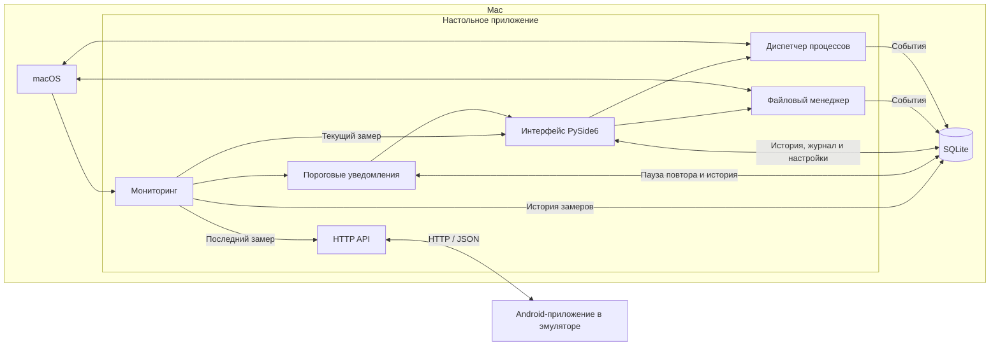
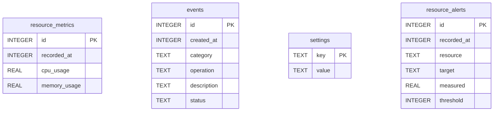

# Проектирование System Monitor

System Monitor собирает показатели Mac и показывает их в настольном приложении. Android-приложение в эмуляторе получает последний замер через локальный HTTP API. История замеров, журнал событий, история пороговых уведомлений и настройки сохраняются в SQLite.

## Архитектура

| Компонент | Технология | Ответственность |
|---|---|---|
| Настольный интерфейс | Python, PySide6 | Мониторинг, файлы, процессы, история и настройки |
| Мониторинг | Python, psutil, средства macOS | Модель и загрузка процессора, использование памяти, список и заполненность накопителей |
| Файловый менеджер | Стандартная библиотека Python | Просмотр рабочего каталога, создание, копирование, перемещение, переименование и удаление. Просмотр свойств и переключение атрибута «Только чтение» |
| Диспетчер процессов | psutil, subprocess | Список процессов, запуск исполняемых файлов и завершение дочерних процессов, запущенных через System Monitor |
| Пороговые уведомления | Python, PySide6 | Сравнение текущих показателей с порогами и показ предупреждений |
| Хранилище | SQLite, sqlite3 | История замеров и уведомлений, журнал и настройки |
| HTTP API | Flask | Выдача последнего замера в JSON и проверка доступности сервера |
| Мобильное приложение | Kotlin, Android Studio | Просмотр показателей, ручное и автоматическое обновление, настройка адреса, порта и интервала |



Модуль мониторинга собирает данные независимо от HTTP-запросов. Интерфейс и API читают один снимок показателей. Сбор данных, дисковые операции и сетевые запросы выполняются вне потока соответствующего интерфейса. Графики ЦП и ОЗУ хранят до 60 последних точек, индикатор накопителя плавно меняет заполнение.

## Структура SQLite

Таблицы создаются автоматически при первом запуске по [схеме SQL](../database/schema.sql). Время хранится как целое число миллисекунд с начала эпохи Unix в UTC. В интерфейсе оно показывается в местном времени. Таблицы независимы и связей по внешним ключам между ними нет.



- `resource_metrics` хранит историю загрузки ЦП и использования ОЗУ. Отсутствующий показатель сохраняется как `NULL`. Запись создаётся, если доступен хотя бы один из двух показателей. Индекс по `recorded_at` используется для выборки за период.
- `events` хранит результаты операций с файлами и процессами. Для каждой операции записываются категория, действие, описание и результат. Журнал и историю можно очищать отдельно после подтверждения.
- `settings` хранит рабочую папку, интервалы обновления и записи и порт API. Начальные значения интервалов — 2 и 10 секунд соответственно, порт — `8080`. Рабочую папку пользователь выбирает при первом переходе к файлам. Интервалы и порт проверяются перед сохранением. Настройки Android хранятся на стороне мобильного приложения.

- `resource_alerts` хранит дату замера, ресурс, том, измеренный процент и порог. Индекс по ресурсу, тому и времени используется при подавлении повторов. Пороги и пауза хранятся в `settings`.

## Обмен между Mac и Android

API на Mac слушает `127.0.0.1` на выбранном порту. В эмуляторе адрес Mac — `10.0.2.2`. Состояние API и действующий порт видны во вкладке «История и настройки». Если новый порт занят, API продолжает работать на предыдущем доступном порту. [Сетевые адреса Android Emulator](https://developer.android.com/studio/run/emulator-networking-address)

| Метод | Назначение | Ответ |
|---|---|---|
| `GET /api/status` | Получить последний замер | `200` с JSON или `503`, пока свежий замер недоступен |
| `GET /api/health` | Проверить, отвечает ли сервер | `200` и `{"status":"ok"}` |

Ответ `/api/status` содержит `computerName`, `timestamp` в ISO 8601 UTC и объекты `cpu`, `memory`, `disk`. В `cpu` передаются `model`, `logicalCores`, `physicalCores` и `usagePercent`. В `memory` и `disk` передаются `totalBytes`, `usedBytes` и `usagePercent`, а также `availableBytes` для памяти и `name` и `freeBytes` для диска. API отдаёт данные выбранного в настольном окне накопителя. Недоступные значения передаются как `null`. Если накопителей нет, `disk` равен `null`. Android показывает «Недоступно» для отсутствующих показателей и состояние связи отдельно от метрик.

## Макеты экранов

| Экран | Содержимое и действия |
|---|---|
| Mac · Мониторинг | Сведения о ЦП и памяти, текущие проценты, два графика, выбор накопителя и анимированный индикатор его заполненности |
| Mac · Файлы | Текущий путь, переход вверх, список файлов и папок, панель свойств и кнопки операций |
| Mac · Процессы | Таблица PID, имени и памяти. Кнопки обновления, запуска и завершения процесса |
| Mac · История и настройки | Период и таблица замеров, журнал событий, отдельные кнопки очистки, рабочая папка, интервалы и порт |
| Mac · Уведомления | Пороги ЦП, памяти и дисков, пауза повтора, история |
| Android · Мониторинг | Имя Mac, состояние связи, показатели ЦП, ОЗУ и диска, время последнего получения и кнопка «Обновить» |
| Android · Настройки | Адрес, порт, интервал, кнопки «Проверить подключение» и «Сохранить» |

## Алгоритмы

### 1. Получение и обновление показателей

```text
При запуске получить постоянные сведения о процессоре.
По таймеру измерить загрузку ЦП на коротком интервале и получить данные ОЗУ и накопителей.
Пометить недоступные поля и сформировать снимок со временем замера.
Заменить общий снимок целиком.
Передать снимок интерфейсу и добавить точки на графики.
Удалить с графиков точки, вышедшие за пределы отображаемого окна.
```

### 2. Операции с файлами и каталогами

```text
Определить исходный и целевой пути относительно рабочего каталога.
Проверить имена, границы рабочего каталога и существование исходных объектов.
Отклонить операцию при выходе за границы каталога или через символическую ссылку.
Для копирования каталога проверить, что дерево целиком находится внутри рабочего каталога и не содержит ссылок.
Перед удалением запросить подтверждение.
Выполнить операцию в пределах рабочего каталога с защитой от перезаписи существующей цели.
Записать успех или ошибку в журнал и показать результат пользователю.
При успехе обновить список файлов.
```

### 3. Запуск и завершение тестового процесса

```text
Для запуска получить путь к исполняемому файлу и запустить его напрямую.
Сохранить дескриптор дочернего процесса, если запуск удался.
Для завершения проверить, что строка списка относится к живому дочернему процессу из этого приложения.
Запросить подтверждение, повторно проверить состояние и послать сигнал завершения через дескриптор.
Проверить результат, записать его в журнал и обновить список процессов.
```

### 4. Сохранение показателей

```text
При запуске создать таблицы, если они отсутствуют.
По таймеру сохранения прочитать последний снимок.
Если снимок отсутствует, уже записан или оба показателя недоступны, пропустить сохранение.
Записать время замера, загрузку ЦП и использование памяти параметризованным запросом.
Подтвердить транзакцию и только после этого отметить снимок как сохранённый.
При ошибке показать её в интерфейсе и дождаться следующего интервала.
```

### 5. Обновление данных на Android

```text
Загрузить сохранённые настройки подключения и проверить значения.
По таймеру или нажатию «Обновить» выполнить GET /api/status в фоновом режиме с тайм-аутом.
Проверить HTTP-статус, формат JSON и диапазоны показателей.
При успехе показать данные и сохранить время их получения в интерфейсе.
При ошибке показать состояние связи и пометить предыдущие значения как устаревшие.
```


### 6. Пороговые уведомления

```text
Считать из настроек пороги ЦП, ОЗУ, дисков и паузу повтора.
Для каждого доступного показателя текущего снимка:
    Если показатель меньше порога или равен ему, пропустить.
    Для диска взять точку монтирования, для ЦП и памяти оставить её пустой.
    Если недавней записи для этой пары ресурс и том нет, вставить уведомление.
После подтверждения транзакции передать уведомление службе UserNotifications macOS.
Если запись не удалась, сообщить об ошибке и продолжить мониторинг.
```
