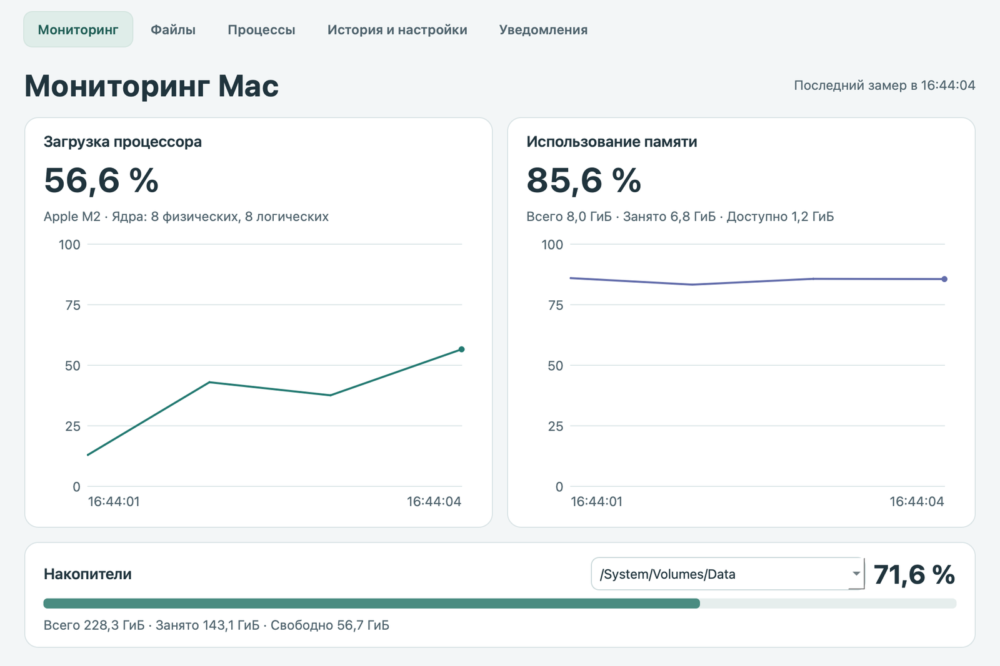
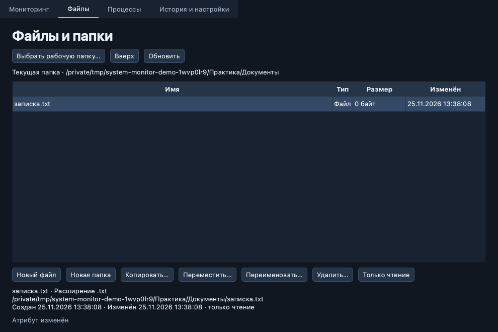
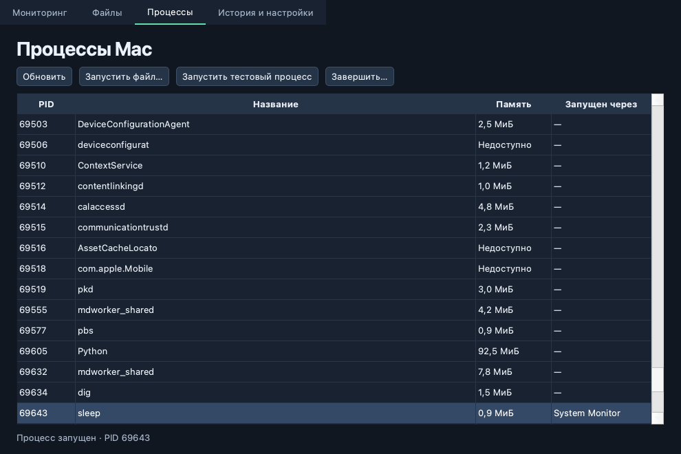
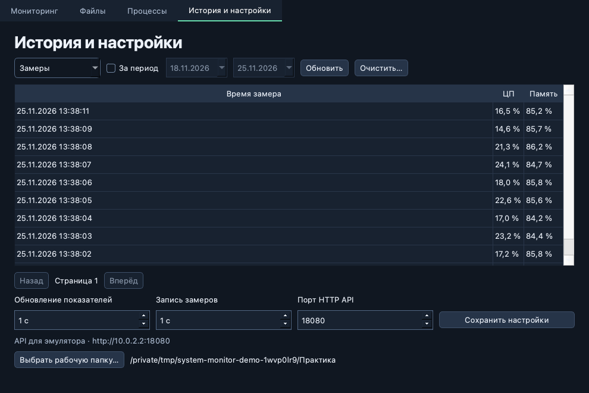
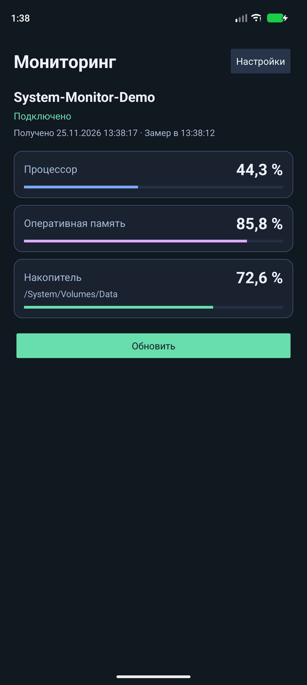
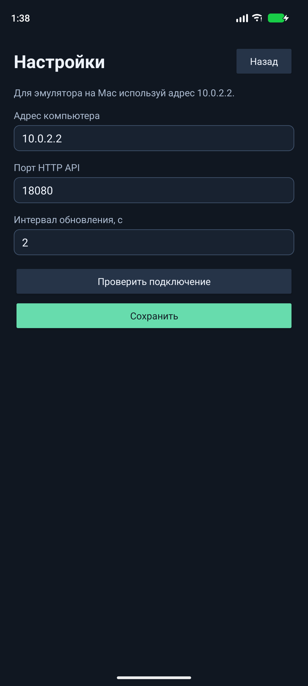
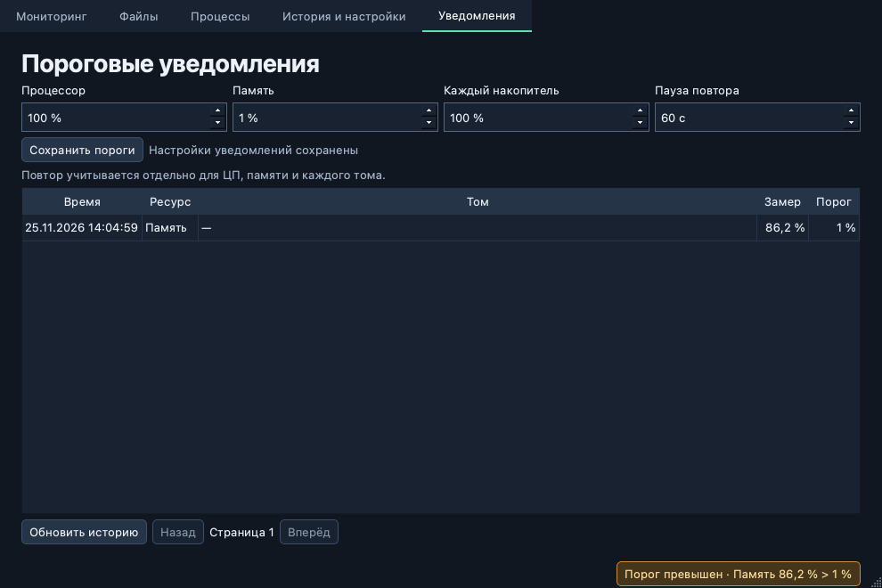

# Руководство оператора

## 1 Назначение программы

System Monitor показывает состояние ресурсов Mac, ведёт историю и журнал, позволяет выполнить действия с тестовыми файлами и процессами. Android-клиент предназначен для просмотра текущих показателей с эмулятора на том же Mac.

## 2 Условия выполнения программы

Для настольной части нужны macOS 13 или новее и Python 3.12. Для установки Android нужны собранный APK и эмулятор с Android 13 или новее. Комплекс проверен на Mac Apple M2 и эмуляторе Pixel 10 Pro XL. Рабочая папка должна быть доступна оператору на чтение и запись.

## 3 Выполнение программы

### 3.1 Подготовка и запуск

Откройте терминал в корне проекта. При первом запуске создайте окружение и установите зависимости. Затем запустите приложение. SQLite и таблицы создаются при запуске. Данные находятся в каталоге `~/Library/Application Support/System Monitor`.

```sh
python3.12 -m venv .venv
.venv/bin/python -m pip install -r requirements.txt
.venv/bin/python -m desktop
```

### 3.2 Мониторинг

Во вкладке «Мониторинг» дождитесь первого замера. Слева показаны модель, ядра и загрузка ЦП, справа — использование памяти. Каждый график хранит до 60 последних точек. В списке «Накопители» выберите том. Полоса состояния меняется плавно и показывает заполненность выбранного тома.



### 3.3 Файлы

1. Откройте «Файлы» и нажмите «Выбрать рабочую папку…». Для демонстрации используйте отдельную тестовую папку.
2. Для перехода внутрь дважды щёлкните по строке папки. Кнопка «Вверх» возвращает к родительской папке.
3. Для создания используйте «Новый файл» или «Новая папка». Для копирования и перемещения выделите строку и укажите папку назначения внутри рабочего каталога.
4. Для просмотра свойств выделите файл. Кнопка «Только чтение» изменяет разрешение владельца на запись. Повторное нажатие возвращает прежнее состояние.
5. Для удаления выделите объект, нажмите «Удалить…» и подтвердите действие. Подтверждение для папки распространяется на содержимое.



### 3.4 Процессы

Вкладка «Процессы» показывает PID, имя и RSS в МиБ. Нажмите «Обновить» для получения нового списка. Кнопка «Запустить файл…» принимает исполняемый файл macOS. Для демонстрации нажмите «Запустить тестовый процесс». Выделенный дочерний процесс можно завершить кнопкой «Завершить…» и подтверждением.



### 3.5 История, журнал и настройки

Во вкладке «История и настройки» выберите «Замеры» или «Журнал событий». Для фильтра отметьте «За период», задайте начало и конец и нажмите «Обновить». Дата конца включается целиком. Кнопки «Назад» и «Вперёд» листают страницы. Кнопка «Очистить…» запрашивает подтверждение и очищает выбранный набор данных.

Настройте интервалы обновления и записи и порт API. Нажмите «Сохранить настройки», чтобы применить их. В строке состояния API указан действующий порт. Выбор рабочей папки доступен также в этой вкладке и сохраняется сразу.



### 3.6 Подключение Android

1. Оставьте настольное приложение открытым.
2. В Android Studio откройте Device Manager и запустите Android-эмулятор. Дождитесь загрузки.
3. Если приложение ещё не установлено, соберите его из каталога mobile командой `./gradlew assembleDebug` и установите APK. В запущенный эмулятор установить его можно через `adb -e install -r app/build/outputs/apk/debug/app-debug.apk` из каталога mobile.
4. Откройте System Monitor. Укажите в «Настройках» адрес 10.0.2.2 и порт из настольной вкладки. Стандартный порт — 8080. На снимках испытательного стенда показан порт 18080.
5. Нажмите «Проверить подключение» и «Сохранить». Для разового запроса на главном экране используйте «Обновить». При выбранном интервале приложение обновляет показатели автоматически.





### 3.7 Завершение работы

Закройте настольное окно. Локальный сервер останавливается вместе с ним. При закрытии или сворачивании Android-клиент прекращает опрос до следующего открытия. Сохранённые настройки остаются в SQLite и в настройках приложения Android соответственно.

### 3.8 Пороговые уведомления

Откройте «Уведомления». Задайте пороги ЦП, памяти и наполнения каждого тома от 0 до 100 %. Задайте паузу повтора от 5 до 3 600 секунд и нажмите «Сохранить пороги». Изменение применяется к следующим замерам. Уведомление появляется при значении выше порога.

Баннер внизу окна виден 10 секунд. Нажмите на него, чтобы открыть историю. В таблице показаны время, ресурс, том, фактическое значение и действовавший порог. Для просмотра более ранних записей используйте «Назад» и «Вперёд». «Обновить историю» возвращает к последним записям.

Для демонстрации временно установите порог памяти 1 % и остальные пороги 100 %. Дождитесь записи, затем убедитесь, что при паузе 60 секунд она не повторяется на каждом замере. Если такое уведомление уже было, дождитесь конца паузы. После демонстрации верните обычные значения.



## 4 Сообщения оператору

| Сообщение | Действие оператора |
|---|---|
| Недоступно | Обновить экран и проверить подключение устройства, наличие тома или разрешения macOS. |
| Объект с таким именем уже существует | Указать другое имя или выбрать другую папку назначения. |
| Путь содержит ссылку или недоступную папку | Выбрать обычную папку внутри текущего рабочего каталога. |
| Недостаточно прав для операции | Проверить права на выбранный файл или папку. |
| Процесс уже завершился | Обновить список процессов. Для демонстрации запустить новый тестовый процесс. |
| Порт занят | Выбрать свободный порт и обновить значение в Android. Если API уже работал, в настройках указан действующий порт. |
| System Monitor на Mac недоступен | Запустить программу Mac, проверить активный порт и адрес 10.0.2.2 в эмуляторе. |
| Сервер вернул некорректные данные | Проверить, что выбран порт System Monitor, затем повторить запрос. |
| Не удалось записать пороговые уведомления | Проверьте доступность SQLite и место на диске. Мониторинг продолжает работать. |
| Устаревшие данные | Восстановить соединение и обновить экран. Отметка времени относится к предыдущему успешному получению. |

## Нормативные ссылки

[ГОСТ 19.505-79. Руководство оператора](https://protect.gost.ru/gost/details/07fec7b0-024f-407f-b5a8-7ebfe7cfa0a9) · [Текст официального издания](https://www.swrit.ru/doc/espd/19.505-79.pdf)
