# Отчёт о прохождении учебной практики

Образовательная организация ______________________________

Студент ______________________________  Группа __________

Руководитель практики ______________________________

Город ____________________   Год 2026

## 1 Анализ требований и проектирование

Цель практики состояла в разработке комплекса System Monitor. Настольное приложение должно получать реальные показатели Mac, управлять файлами и тестовыми процессами и предоставлять состояние ресурсов по HTTP. Android-клиент должен получать данные на том же Mac через эмулятор. Продолжительность практики по заданию составляет 72 академических часа.

Python подходит для работы с macOS через psutil и стандартную библиотеку. PySide6 используется для интерфейса и рабочих потоков. SQLite хранит данные без отдельного сервера. Flask обрабатывает два маршрута HTTP для чтения. В Android используются Kotlin, системные представления и HttpURLConnection. Такая структура позволяет проверять файловые операции, настройки и API отдельно от окон.

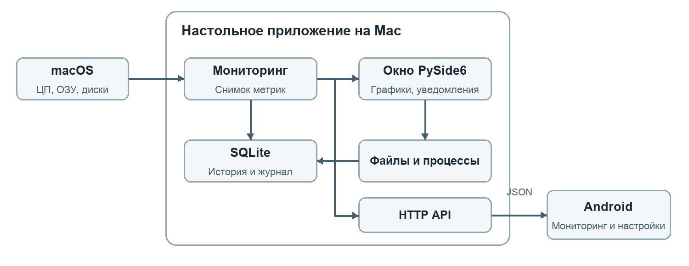

## 2 Организация взаимодействия с аппаратным обеспечением

Модель процессора определяется системным вызовом sysctl. Количество логических и физических ядер, использование памяти и заполненность томов получаются через psutil. Загрузка процессора измеряется на интервале 0,1 с. Данные записываются в неизменяемый снимок с отметкой времени UTC. Настольное окно получает новый снимок по таймеру, а HTTP API читает последний опубликованный результат. Неполные данные сохраняют доступные поля.

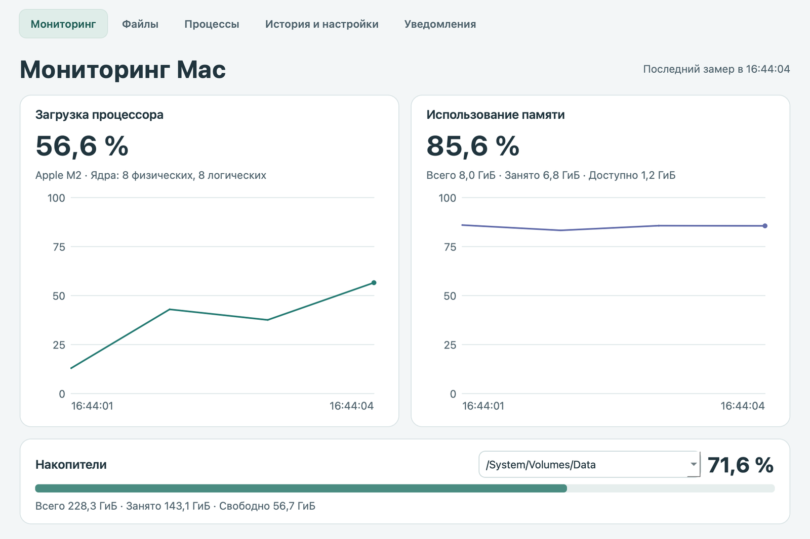

## 3 Управление файлами, атрибутами и каталогами

Оператор выбирает корневую папку, переходит по вложенным папкам и может создавать, копировать, перемещать, переименовывать и удалять объекты. Доступны свойства файла и переключение разрешения владельца на запись. Изменяющие операции заносятся в журнал.

Пути проверяются относительно открытого рабочего каталога. При попытке выйти за его границы, воспользоваться символической ссылкой или заменить одноимённый объект программа показывает ошибку. Удаление отклоняется до явного подтверждения. В демонстрации файл был переименован, скопирован, перемещён, а на копии включён атрибут «Только чтение».

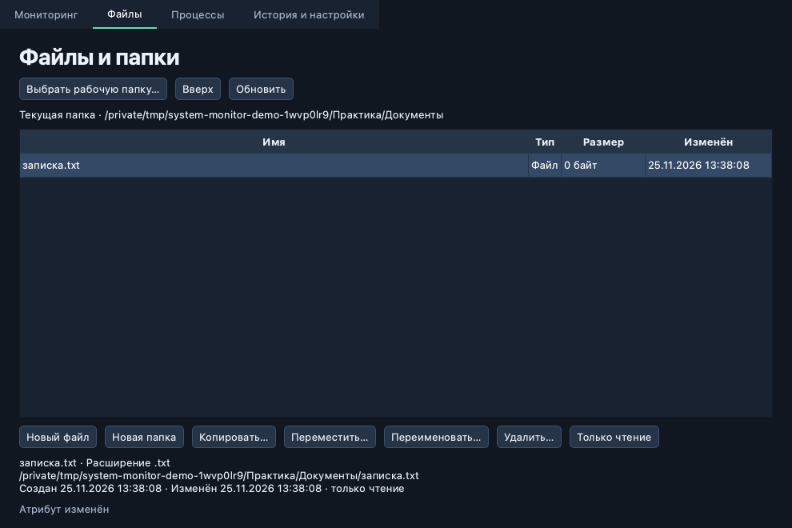

## 4 Управление процессами

Диспетчер получает PID, имя и RSS через psutil. Выбранный исполняемый файл запускается напрямую через subprocess. Для завершения используется сохранённый дескриптор дочернего процесса. Оператор сначала подтверждает действие. Само приложение и сторонние процессы недоступны для завершения из окна.

На испытании запущен sleep. Приложение выделило его в списке. После отмены процесс остался запущенным, после подтверждения исчез из списка. Попытка завершить процесс самого System Monitor была заблокирована.

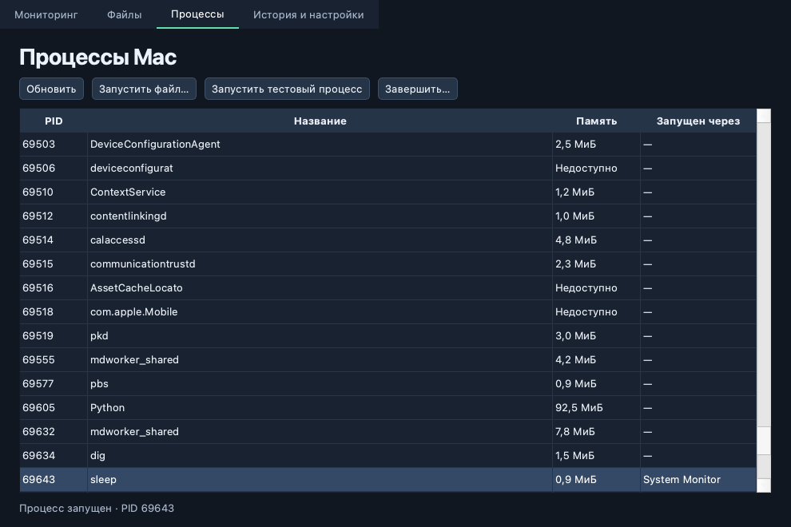

## 5 Работа с базой данных

SQLite автоматически создаёт четыре таблицы. resource_metrics хранит время замера и проценты ЦП и памяти. events хранит категорию, операцию, описание и результат. settings хранит параметры по именам. resource_alerts хранит историю пороговых уведомлений. База обновляется параметризованными запросами. Новые метрики записываются по отдельному таймеру, а записи журнала появляются после операций с файлами и процессами.

Даты фильтра преобразуются в границы суток. Дата конца входит в период целиком. История и журнал очищаются после подтверждения. Настройки сохраняются после повторного открытия программы.

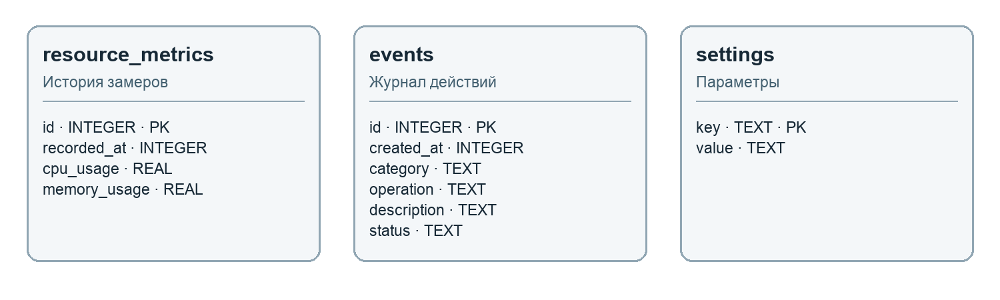

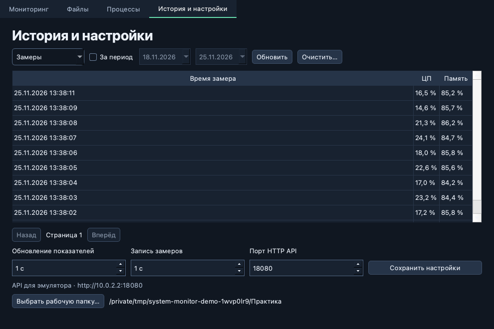

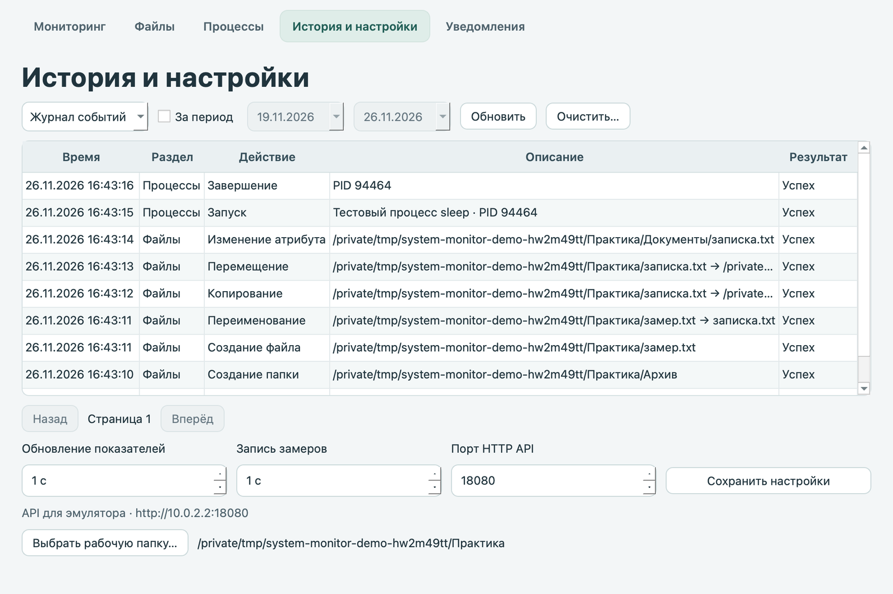

## 6 Работа с графикой и анимацией

Виджеты MetricChart отрисовывают временные ряды ЦП и ОЗУ средствами QPainter. Отображается до 60 последних точек на график. Ось времени строится по меткам фактических замеров. Для заполненности выбранного диска QPropertyAnimation изменяет значение полосы за 350 мс. Промежуточное положение и конечное значение проверены отдельно. Интерфейс с обоими рядами показан на рисунке 2.

## 7 Разработка мобильного приложения

Мобильное приложение содержит экран мониторинга и экран настроек. Сетевой запрос выполняется в отдельном потоке, результат выводится в основном потоке. Клиент проверяет формат адреса, порт, интервал, статус HTTP и структуру JSON. При потере связи последнее успешно полученное значение сохраняется на экране и помечается как устаревшее.

Mac принимает подключения на 127.0.0.1. Из эмулятора сервер доступен по 10.0.2.2. На испытательном стенде использован порт 18080. На снимках и в примере ответа показано условное имя стенда System-Monitor-Demo. Метрики получены с Mac.

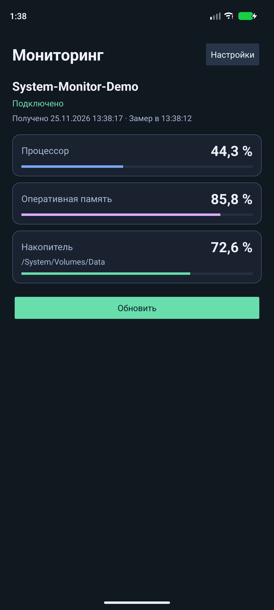

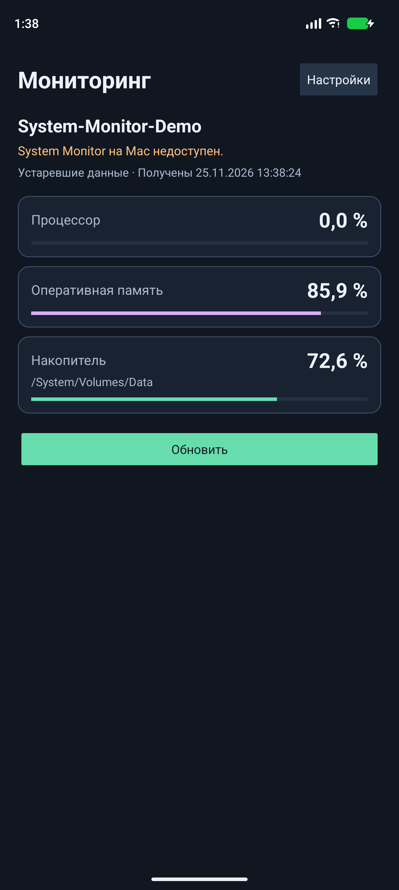

Фактический ответ с контрольного стенда получен через GET /api/status.

```json
{
  "computerName": "System-Monitor-Demo",
  "cpu": {
    "logicalCores": 8,
    "model": "Apple M2",
    "physicalCores": 8,
    "usagePercent": 11.5
  },
  "disk": {
    "freeBytes": 58166755328,
    "name": "/System/Volumes/Data",
    "totalBytes": 245107195904,
    "usagePercent": 72.6,
    "usedBytes": 154245976064
  },
  "memory": {
    "availableBytes": 1359314944,
    "totalBytes": 8589934592,
    "usagePercent": 84.2,
    "usedBytes": 7230619648
  },
  "timestamp": "2026-11-25T10:38:11.822Z"
}
```

## 8 Отладка программных модулей

| Случай | Инструмент и наблюдение | Результат |
|---|---|---|
| Задержка запуска HTTP | faulthandler показал стек: wsgiref вызывал socket.getfqdn, хотя сервер использовал 127.0.0.1. | Убран обратный поиск имени при привязке. Тест подтверждает запуск без обращения к getfqdn. |
| Возврат из настроек Android | Android Lint обнаружил GestureBackNavigation в прежнем обработчике onBackPressed. | Подключён OnBackInvokedCallback. Проверены сборка, Lint и возврат из настроек в эмуляторе. |
| Адрес bad/path | Модульный тест воспроизвёл ошибку. В jdb установлена точка останова и выполнен шаг. В локальных переменных видны узел bad и путь /path. | Валидация проверяет также путь, параметры и фрагмент. Сценарий AND-04 проходит после исправления. |

В приложении А приведены фрагменты исходной диагностики и снимки вывода инструментов при её воспроизведении. Описание причин и исправлений приведено в заметках по отладке. [Заметки по отладке](https://github.com/Koryza/practika-echebka/blob/main/docs/debugging.md)

## 9 Тестирование и анализ результатов

Первый полный прогон включал 28 сценариев. Проверки охватили оборудование, файлы, процессы, SQLite, графики, API и Android. Пройдено 27 сценариев, один завершился ошибкой. Дефект BUG-001 проявился в Android при проверке адреса с путём. После исправления выполнен повторный полный прогон. После рефакторинга и оптимизации проведена регрессия на тех же сценариях.

| Прогон | Всего | Пройдено | Ошибки | Блокировано | Не запускалось |
|---|---:|---:|---:|---:|---:|
| Первоначальный | 28 | 27 | 1 | 0 | 0 |
| После устранения BUG-001 | 28 | 28 | 0 | 0 | 0 |
| После рефакторинга и оптимизации | 28 | 28 | 0 | 0 | 0 |

После доработок прошли 25 автотестов Python и 3 автотеста Kotlin. Android Lint завершился с тремя предупреждениями о версиях инструментов и целевом SDK, ошибок нет.

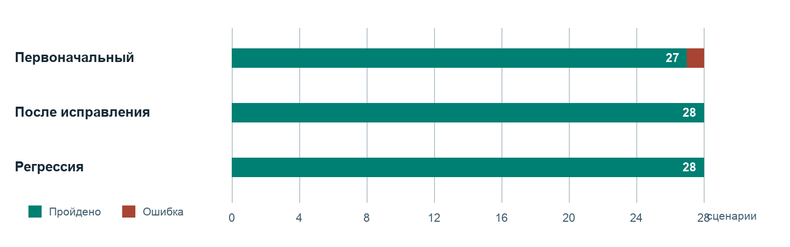

[Протокол первоначальных испытаний](https://github.com/Koryza/practika-echebka/blob/main/docs/test-results.pdf) · [Результаты регрессии](https://github.com/Koryza/practika-echebka/blob/main/docs/optimization-results.pdf)

## 10 Рефакторинг и оптимизация

Диалоги удаления, завершения процесса и очистки объединены в функцию confirm_action. Обработка отмены и Escape общая для трёх вкладок. Файловые операции и журнал вынесены из Qt-адаптера в FileSession. Qt-слой пересылает запросы и результаты через сигналы.

При навигации ранее выполнялись две выборки содержимого каждой папки. Теперь используется результат, полученный при первой проверке. В сравнении на папках по 2 500 файлов проведено по 21 измерению после четырёх разогревающих проходов. Медиана перехода в подпапку и обратно снизилась с 28,562 до 13,773 мс, или на 51,8 %. Обработчик обновления по-прежнему читает актуальное содержимое.

[Объединил диалоги подтверждения](https://github.com/Koryza/practika-echebka/commit/04e06ce9fecbbb4b246539022bbfbdf36e3b206d) · [Вынес файловые операции из интерфейса](https://github.com/Koryza/practika-echebka/commit/7f254c2edead6cd85ba9cacd6df2fcf9e9c105ba) · [Убрал повторное чтение папок](https://github.com/Koryza/practika-echebka/commit/6a28b0d29d86a5d70b1ee7efed1eecdd641976f0)

[Методика замера и результаты](https://github.com/Koryza/practika-echebka/blob/main/docs/optimization-results.pdf)

## 11 Разработка программной документации

| Документ | Стандарт | Содержание |
|---|---|---|
| Техническое задание | ГОСТ 19.201-78 | Цель, требования, этапы и приёмка |
| Описание программы | ГОСТ 19.402-78 | Архитектура, модули, алгоритмы, данные |
| Программа и методика испытаний | ГОСТ 19.301-79 | Стенд, критерии сравнения и 33 сценария |
| Руководство оператора | ГОСТ 19.505-79 | Запуск, работа с вкладками, Android и сообщения |

Разделы описывают фактическую конфигурацию Mac и Android. Протокол и измерения оформлены отдельными документами.

## 12 Реализация индивидуального задания

Вариант № 8 «Система пороговых уведомлений» предназначен для предупреждения оператора о высокой загрузке процессора, использовании памяти или заполненности накопителя. В настольной вкладке можно задать три порога от 0 до 100 % и паузу повтора от 5 до 3 600 секунд. Исходные значения — 90 % и 60 секунд.

Источником служит тот же снимок, который обновляет графики. Для ЦП, ОЗУ и каждого тома модуль сравнивает доступный процент с порогом. Равенство порогу не считается превышением. При превышении SQLite проверяет, была ли запись о том же ресурсе и томе в пределах паузы. Проверка и вставка выполняются одним запросом. После подтверждения записи приложение передаёт предупреждение в Центр уведомлений macOS. Отдельная таблица resource_alerts сохраняет время, ресурс, точку монтирования, замер и порог. Защита от повторов действует также после перезапуска. Недоступные метрики пропускаются, ошибка SQLite отображается в окне.

Модель AlertSettings проверяет границы ввода. Функция threshold_alerts сравнивает показания без зависимости от Qt. SampleWorker выполняет запросы в существующем рабочем потоке, а AlertsPanel принимает сигналы, показывает таблицу и отправляет настройки. Так модуль переиспользует сбор показателей и хранилище. Для проверки повтора не требуется таймер на каждый ресурс. Компонент NotificationSender использует UserNotifications и запрашивает разрешение macOS. Уведомления доставляются и при свёрнутом окне. Сохранённые предупреждения доступны на вкладке «Уведомления».

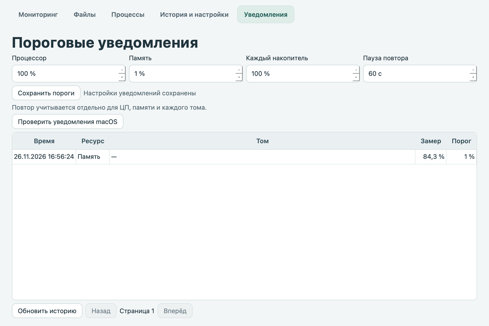

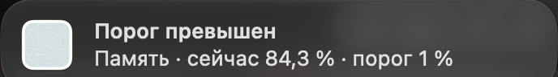

| Сценарий | Фактический результат | Статус |
|---|---|---|
| ALR-01 Системное уведомление и история | При свёрнутом окне macOS показала предупреждение о превышении порога памяти 1 %. На вкладке «Уведомления» появилась запись SQLite. | Passed |
| ALR-02 Подавление повторов | После трёх замеров в пределах 60 с в истории осталась одна запись. | Passed |
| ALR-03 Недопустимый ввод | Модель отклонила 101 %, −1 % и паузу 4 с. Интерфейс ограничивает поля. | Passed |
| ALR-04 Ошибка SQLite | При имитации отказа выведено сообщение, новые замеры продолжились. | Passed |
| ALR-05 Перезапуск | Порог и история сохранены. Повтор до конца паузы подавлен. | Passed |

Шесть новых автотестов проверили строгую границу порога, недоступные показания, отдельный учёт дисков, паузу после открытия SQLite, совместимость со старой базой, конкурентные записи и откат при ошибке. Всего прошёл 31 тест Python. Итог по модулю подтверждает выполнение требований варианта в настольном приложении.

## 13 Заключение

Разработан комплект из настольного приложения, SQLite, локального API и Android-клиента. В проверенной конфигурации комплекс получает реальные метрики, записывает историю, ограничивает файловые операции выбранной папкой и управляет тестовыми дочерними процессами. Android подключается к API и корректно сообщает об утрате связи. Индивидуальный модуль показывает пороговые уведомления и ведёт отдельную историю.

Основные трудности были связаны с запуском локального сервера и проверкой адреса Android. Причины установлены диагностикой стека, статическим анализом и отладчиком. Изменения структуры кода упростили проверку файловой логики. Измерения подтвердили сокращение времени навигации. Работа охватывала проектирование, системное программирование, работу с SQLite, разработку Android, отладку и тестирование.

Комплекс рассчитан на macOS и Android-эмулятор на том же компьютере. Работа на физическом телефоне в локальной сети не проверялась. Перемещение файлового менеджера между томами ограничено.

## 14 Ссылка на репозиторий

Код, тесты, документы и инструкции размещены в репозитории проекта на GitHub. В задании указано размещение на GitLab. Допустимость GitHub должен подтвердить преподаватель. [Репозиторий System Monitor](https://github.com/Koryza/practika-echebka)

## Приложение А. Диагностические материалы

Снимки сделаны в окне просмотра фактического вывода инструментов при повторной диагностике. Пути окружения сокращены.
Фрагмент стека faulthandler при задержке привязки HTTP-сервера. Имена каталогов и строки сторонних файлов опущены.

```text
Timeout (0:00:04)!
socket.py          in getfqdn
http/server.py     in server_bind
wsgiref/simple_server.py in server_bind
wsgiref/simple_server.py in make_server
desktop/http_api.py in start
```

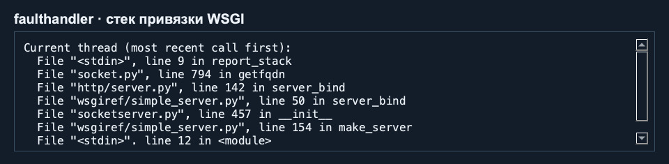

Фрагмент вывода Android Lint до перехода на системный обработчик возврата.

```text
Error: onBackPressed is no longer called for back gestures
[GestureBackNavigation]
Lint found 1 error and 5 warnings.
```

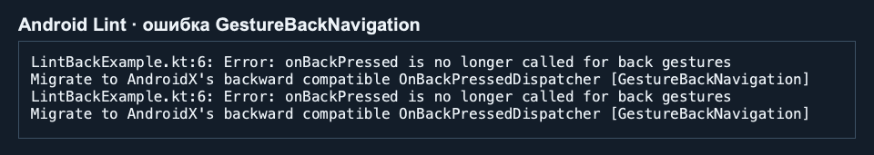

Фрагмент сессии jdb после выполнения команды next в примере разбора URI.

```text
Breakpoint hit: AddressCheck.main(), line=8
Step completed: AddressCheck.main(), line=9
Local variables:
host = "bad/path"
parsedHost = "bad"
parsedPath = "/path"
```

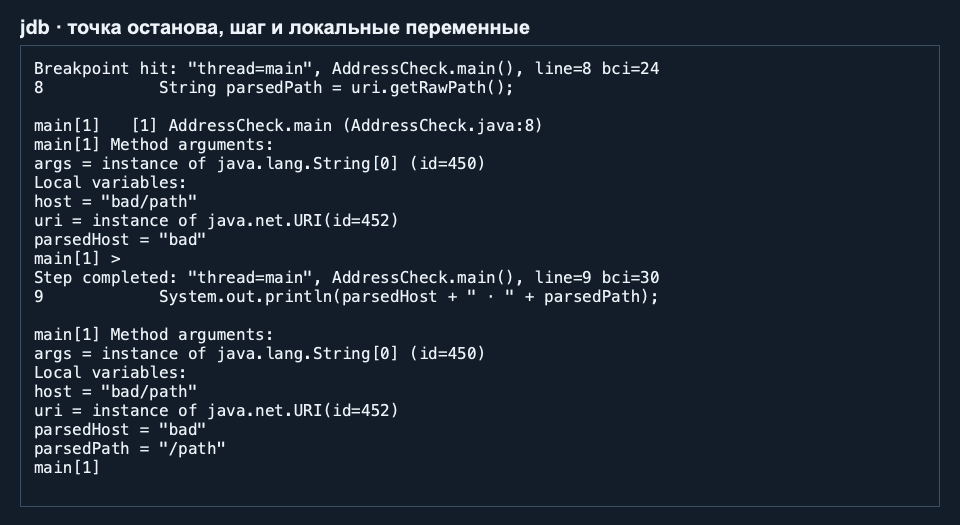
