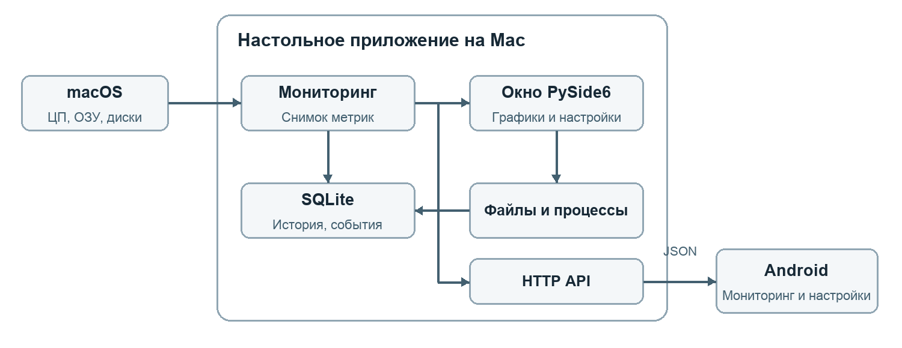
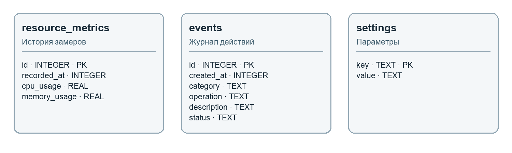

# Описание программы

## 1 Общие сведения

Наименование программного комплекса — System Monitor. Рабочая реализация состоит из настольного приложения для macOS и Android-клиента версии 1.0. Настольная часть написана на Python 3.12, использует PySide6 6.10.2, psutil 7.2.2, Flask 3.1.3 и sqlite3. Android-клиент реализован на Kotlin и Android SDK. Сборка использует Gradle Wrapper.

## 2 Функциональное назначение

Комплекс решает задачи мониторинга компьютера, управления файлами в выбранной рабочей папке, запуска и завершения дочерних процессов и просмотра событий. Android-клиент отображает текущие показатели. Команды управления с Android отсутствуют. API слушает 127.0.0.1. Эмулятор на том же Mac обращается к 10.0.2.2.

## 3 Описание логической структуры



| Модуль | Назначение |
|---|---|
| monitor.py, sampling.py | Получение данных macOS, формирование снимков и запись по отдельному таймеру |
| monitor_window.py, metric_chart.py | Интерфейс, последний снимок, выбор накопителя, отрисовка и анимация |
| workspace_files.py, file_session.py, files_panel.py | Проверки путей, файловые операции, навигация и журнал |
| processes.py, process_panel.py | Перечисление процессов, управление дескрипторами собственных дочерних процессов |
| storage.py, history_panel.py, database/schema.sql | Схема SQLite, чтение и запись, фильтр истории, пагинация и настройки |
| http_api.py | Локальный сервер и снимок, общий для текущего состояния и выбранного диска |
| MainActivity, MonitorClient, ConnectionSettings, Screens | Экраны Android, фоновые запросы, проверка ответов и сохранение параметров |

### 3.1 Структура базы данных



Таблицы независимы. Первичные ключи истории и событий целочисленные. Для настроек первичным ключом служит имя параметра. Индекс по времени замера поддерживает выборку по периоду. История и журнал выводятся страницами по 100 строк. Граница по идентификатору сохраняет положение страниц при появлении новых записей до очередного обновления списка.

### 3.2 Алгоритмы

| Алгоритм | Последовательность |
|---|---|
| А1. Снятие показателей | При старте считать модель и ядра ЦП. По таймеру измерить загрузку ЦП за 0,1 с, прочитать ОЗУ и список дисков. Сформировать неизменяемый снимок и передать его окну. |
| А2. Файловая операция | Проверить имя и открыть папки внутри выбранного каталога. Проверить тип объекта, конфликт и подтверждение удаления. Выполнить операцию и записать результат. Обновить список. |
| А3. Процессы | Запустить исполняемый файл через subprocess и сохранить дескриптор. При запросе завершения проверить принадлежность и состояние, получить подтверждение, послать сигнал и дождаться результата. |
| А4. Сохранение замера | По отдельному таймеру взять последний снимок. Пропустить отсутствующий, уже сохранённый или полностью недоступный замер. Вставить параметры в SQLite и отметить снимок как сохранённый после транзакции. |
| А5. Получение данных Android | Проверить параметры, выполнить GET в рабочем потоке, проверить HTTP и JSON. Показать данные и время получения. При ошибке пометить предыдущие значения как устаревшие. |

Переход в каталог использует один список, полученный во время проверки доступности. Отдельное ручное обновление повторно читает файловую систему. Файловые, процессные и SQLite-операции интерфейса выполняются в рабочих потоках. Сетевой слой читает согласованную пару «снимок и выбранный накопитель».

## 4 Используемые технические средства

Программа работает на Mac с экраном, клавиатурой или указателем и доступом к файловой системе. Подтверждённый стенд — Mac Apple M2, 8 ГиБ ОЗУ, macOS 27.2. Android проверен в эмуляторе Pixel 10 Pro XL с API 37. Для запуска APK требуется Android 13 или новее.

## 5 Вызов и загрузка

Из каталога проекта выполнить `.venv/bin/python -m desktop`. При первом запуске создать окружение Python и установить зависимости из requirements.txt. Android-клиент собирается командой `./gradlew assembleDebug` из каталога mobile и устанавливается в эмулятор через adb либо Android Studio.

## 6 Входные данные

Программа принимает системные метрики macOS, параметры рабочего каталога и интервалов, путь к исполняемому файлу, действия пользователя и дату фильтра истории. В Android вводятся имя или IP компьютера, порт и интервал. Допустимые диапазоны проверяются перед сохранением. Адрес Android вводится без схемы, пути, параметров запроса и фрагмента.

## 7 Выходные данные

Настольное приложение выводит текущие проценты и байтовые объёмы, графики, список файлов и процессов, историю и журнал. GET /api/health возвращает JSON со status = ok. GET /api/status возвращает computerName, timestamp, cpu, memory и disk. Единицы — байты и проценты. timestamp передаётся в UTC. Недоступные значения передаются как null, отсутствие актуального снимка возвращает HTTP 503. Клиент показывает время получения по своему часовому поясу.

## Приложение А. Псевдокод алгоритмов

### А.1. Получение и обновление показателей

```text
При запуске получить постоянные сведения о процессоре.
По таймеру измерить загрузку ЦП на коротком интервале и получить данные ОЗУ и накопителей.
Пометить недоступные поля и сформировать снимок со временем замера.
Заменить общий снимок целиком.
Передать снимок интерфейсу и добавить точки на графики.
Удалить с графиков точки, вышедшие за пределы отображаемого окна.
```

### А.2. Операции с файлами и каталогами

```text
Определить исходный и целевой пути относительно рабочего каталога.
Проверить имена, границы рабочего каталога и существование исходных объектов.
Отклонить операцию при выходе за границы каталога или через символическую ссылку.
Для копирования каталога проверить, что дерево целиком находится внутри рабочего каталога и не содержит ссылок.
Перед удалением запросить подтверждение.
Выполнить операцию в пределах рабочего каталога с защитой от перезаписи существующей цели.
Записать успех или ошибку в журнал и показать результат пользователю.
При успехе обновить список файлов.
```

### А.3. Запуск и завершение тестового процесса

```text
Для запуска получить путь к исполняемому файлу и запустить его напрямую.
Сохранить дескриптор дочернего процесса, если запуск удался.
Для завершения проверить, что строка списка относится к живому дочернему процессу из этого приложения.
Запросить подтверждение, повторно проверить состояние и послать сигнал завершения через дескриптор.
Проверить результат, записать его в журнал и обновить список процессов.
```

### А.4. Сохранение показателей

```text
При запуске создать таблицы, если они отсутствуют.
По таймеру сохранения прочитать последний снимок.
Если снимок отсутствует, уже записан или оба показателя недоступны, пропустить сохранение.
Записать время замера, загрузку ЦП и использование памяти параметризованным запросом.
Подтвердить транзакцию и только после этого отметить снимок как сохранённый.
При ошибке показать её в интерфейсе и дождаться следующего интервала.
```

### А.5. Обновление данных на Android

```text
Загрузить сохранённые настройки подключения и проверить значения.
По таймеру или нажатию «Обновить» выполнить GET /api/status в фоновом режиме с тайм-аутом.
Проверить HTTP-статус, формат JSON и диапазоны показателей.
При успехе показать данные и сохранить время их получения в интерфейсе.
При ошибке показать состояние связи и пометить предыдущие значения как устаревшие.
```

## Нормативные ссылки

[ГОСТ 19.402-78. Описание программы](https://protect.gost.ru/gost/details/5e9b5f2e-925d-4a92-a100-53f952c8a2a1) · [Текст официального издания](https://files.stroyinf.ru/Data2/1/4294850/4294850112.pdf)
